<picture>
  <source media="(prefers-color-scheme: dark)" srcset="assets/terminal-dark.svg">
  
</picture>

hey, I'm Magnus. I build web products around maps and geography: data tools, multiplayer games and guides for players. I'm the founder of **[MagnusGeo](https://magnusgeo.magnusmagi.com)**, and before that I built backend and internal tools for brands like Walgreens, CVS and GUESS.

I like shipping small things fast and keeping them running. The live board below says which ones are up today.

**[magnusmagi.com](https://magnusmagi.com)** &nbsp;·&nbsp; **[works](https://magnusmagi.com/works)** &nbsp;·&nbsp; **[get in touch](https://magnusmagi.com/contact)**

 

<a href="https://magnusgeo.magnusmagi.com">
  <picture>
    <source media="(prefers-color-scheme: dark)" srcset="assets/magnusgeo-dark.svg">
    
  </picture>
</a>

GeoGuessr's ladder only shows you the top of the pile, so I started crawling the rest. MagnusGeo now tracks **1.18M players** across **11 leaderboards** with **6.1M profile snapshots** since June 2026: records, seasons, World League, all in Turkish and English. Twelve crawl jobs keep it fresh, and I'm still the person checking it first every morning. **[magnusgeo.magnusmagi.com](https://magnusgeo.magnusmagi.com)** &nbsp;·&nbsp; **[how it works](https://magnusmagi.com/works/magnusgeo)**

 

<picture>
  <source media="(prefers-color-scheme: dark)" srcset="assets/live-dark.svg">
  
</picture>

### Other things I've built

  <a href="https://hidenseek.magnusmagi.com"><picture><source media="(prefers-color-scheme: dark)" srcset="assets/tile-hidenseek-dark.svg"></picture></a>
  <a href="https://cardinal.magnusmagi.com"><picture><source media="(prefers-color-scheme: dark)" srcset="assets/tile-cardinal-dark.svg"></picture></a>

  <a href="https://geo.magnusmagi.com"><picture><source media="(prefers-color-scheme: dark)" srcset="assets/tile-magigeo-dark.svg"></picture></a>
  <picture><source media="(prefers-color-scheme: dark)" srcset="assets/tile-cityshot-dark.svg"></picture>

  <a href="https://github.com/MagnusMagi/Magnus-wire"><picture><source media="(prefers-color-scheme: dark)" srcset="assets/tile-magiwire-dark.svg"></picture></a>
  <a href="https://github.com/MagnusMagi/MagiCube"><picture><source media="(prefers-color-scheme: dark)" srcset="assets/tile-magicube-dark.svg"></picture></a>

  <a href="https://airflow.magnusmagi.com"><picture><source media="(prefers-color-scheme: dark)" srcset="assets/tile-airflow-dark.svg"></picture></a>

### What I mostly work with

<picture>
  <source media="(prefers-color-scheme: dark)" srcset="assets/stack-dark.svg">
  
</picture>

### My week, itemised

  <picture>
    <source media="(prefers-color-scheme: dark)" srcset="assets/receipt-dark.svg">
    
  </picture>

Tallinn, Estonia &nbsp;·&nbsp; UTC+2 &nbsp;·&nbsp; every graphic here is a hand-rolled SVG, refreshed daily by <a href="scripts/generate.mjs">one Node script</a>

